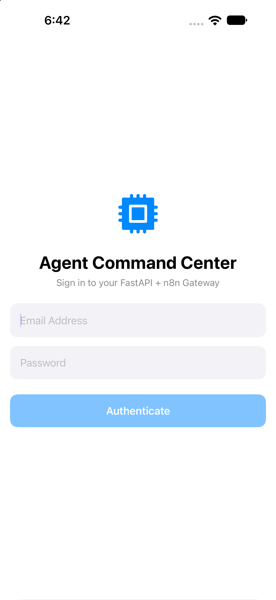
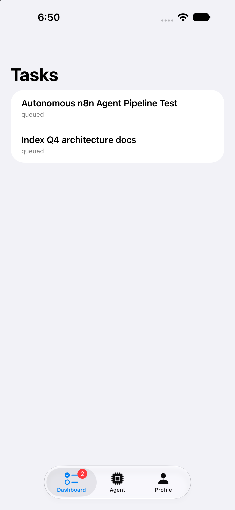
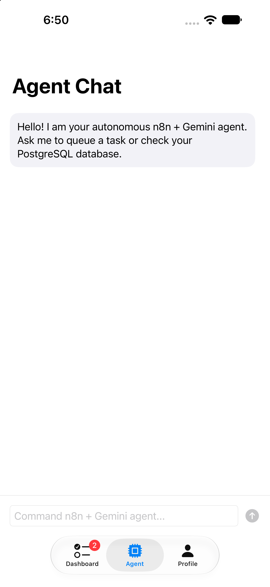
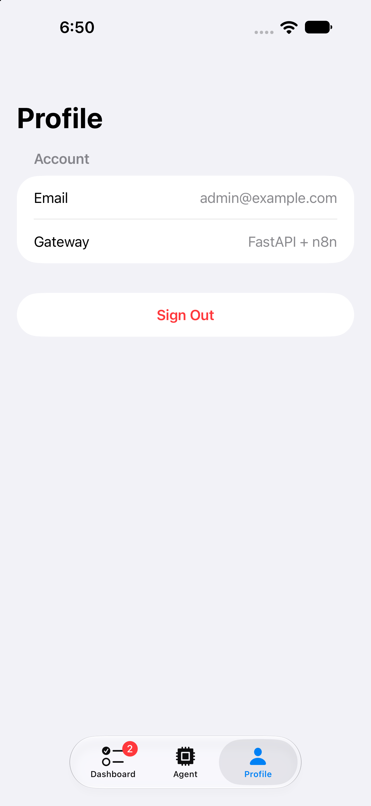

# AI Agent Command Center (iOS Client)

A native **SwiftUI** mobile command center built to orchestrate an autonomous **n8n + Google Gemini AI Agent** and a **Python FastAPI + PostgreSQL** backend.

🔗 **Backend & Agent Repository:** [ai-automation-platform](https://github.com)

## Key Features
* **Secure Keychain Authentication:** Integrates with FastAPI OAuth2 JWT login (`/api/v1/auth/login`) and persists tokens securely in the iOS Keychain using Apple's `Security` framework.
* **Conversational Agent Control:** Stateful chat interface (`sessionId` memory) allowing users to create, query, update, and delete database tasks in plain English.
* **Real-Time Dashboard Sync:** Automatically refreshes the PostgreSQL task queue and tab badge count whenever the AI agent executes backend tool calls.
* **Modern Swift Architecture:** Built with SwiftUI, Swift Concurrency (`async/await`), `@MainActor` ViewModels, and zero third-party dependencies.
## App Screenshots
| Authentication | Live Task Dashboard | Agent Chat (CRUD) | Account & Gateway |
| :---: | :---: | :---: | :---: |
|  |  |  |  |
## Project Structure
* `MyApp.swift` — App entry point, session validation, and auth state routing.
* `AuthViewModel.swift` & `LoginView.swift` — FastAPI OAuth2 authentication and iOS Keychain storage.
* `MainTabView.swift` — Multi-tab navigation (`Dashboard`, `Agent`, `Profile`).
* `DashboardViewModel.swift` — Live task fetching, pull-to-refresh, and swipe-to-delete.
* `AgentChatViewModel.swift` — Persistent session chat and automatic dashboard sync triggers.
* `APIService.swift` — Typed `URLSession` networking layer for FastAPI and n8n webhooks.

## Quick Start
1. Ensure the [ai-automation-platform](https://github.com) Docker stack is running locally (`http://localhost/docs` and `http://localhost:5678`).
2. Open the `.xcodeproj` file in **Xcode 15+**.
3. Update `baseURL` and `n8nWebhookURL` in `APIService.swift` if running on a physical device or cloud server.
4. Press **Cmd + R** to launch in the iOS Simulator.

## Context-Driven AI Engineering (`docs/` & `skills/`)
To prevent AI code drift and enforce senior iOS architectural standards, this repository uses a structured **6-file `docs/` context engine** paired with custom **`SKILL.md` agent playbooks**:
- `docs/PRD.md` & `docs/ARCHITECTURE.md` — Product scope and MVVM + Swift Concurrency system boundaries.
- `docs/RULES.md` & `docs/DESIGN.md` — Keychain security guardrails, `@MainActor` rules, and SwiftUI UI tokens.
- `docs/TASKS.md` & `docs/MEMORY.md` — Phased execution checklist and persistent architectural decision log.
- `skills/` — Custom `SKILL.md` workflows (`swiftui-feature-builder` and `api-contract-sync`) that guide AI coding assistants to read project rules before writing code.
